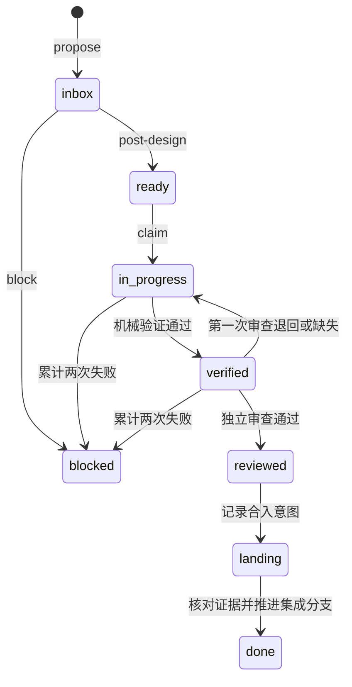

# Akzio 单机研发循环

`outputs/loop/state/loop.sqlite3` 是任务、wave 租约、验证证据和审计事件的权威状态。`issue_hub.py` 负责状态迁移与 Git 操作。任务 worktree 位于 `outputs/loop/worktrees/task-N`，集成分支为本地 `loop/nightly`。主工作区仅供巡检和设计时核对。旧 GitHub Issue、`ledger.jsonl` 和 `issue-N` worktree 保留在原处，如需恢复其中的工作，应按证据重新登记任务。

## 启动与恢复

从仓库根目录运行。`init` 初始化本地状态，`status` 返回本地队列和 `dirty_main_files`。`wave` 启动一次队列动作，`daemon` 在每次轮询执行 `daily-report --if-due` 并尝试启动一轮。`daily-report` 立即写本地报告，报告保存在 `outputs/loop/reports/`。

```bash
bash .agents/loop/bin/loop_daemon.sh init
bash .agents/loop/bin/loop_daemon.sh status
bash .agents/loop/bin/loop_daemon.sh wave
bash .agents/loop/bin/loop_daemon.sh daemon
bash .agents/loop/bin/loop_daemon.sh daily-report
```

`list --status blocked` 查看需要处理的阻塞任务，省略 `--status` 列出所有任务。

```bash
python3 .agents/loop/bin/issue_hub.py list --status blocked
```

启动器使用本机已配置的 `agy`，可通过 `AGY_BIN` 指定其路径，通过 `LEADER_MODEL` 指定 AGY 模型标识。`WAVE_INTERVAL_SECS` 默认 `900` 秒。`start-wave` 取得两小时的 SQLite 租约后，启动器从仓库根目录运行带 `--sandbox` 的阻塞式 headless 会话，单次等待上限 110 分钟。`busy` 表示已有 wave 持有租约，此时跳过启动。

会话日志位于 `outputs/loop/logs/`。启动器以 `stream-json` 的 `init` 事件核对工作目录和 `loop-leader` 角色，确认同一会话的最终结果为 `SUCCESS` 后，凭本轮标识调用 `finish-wave`。会话中断或终态无法确认时，租约到期后由下一轮接管任务。每轮使用新的租约，已有候选提交与 worktree 由 `claim` 接管。

## 角色约定

| 角色 | 初始 Prompt 的精确首行 | 职责 |
|---|---|---|
| `loop-leader` | `[AKZIO-LOOP-LEADER] W` | 按 `poll` 结果设计任务或调度实现、验证、合入 |
| `issue-scout` | `[AKZIO-LOOP-SCOUT] W` | 读取本地证据并登记去重的任务 |
| `rust-worker` | `[AKZIO-LOOP-WORKER] W N A` | 按文件白名单在隔离 worktree 修改、定向测试和提交 |
| `rust-verifier` | `[AKZIO-LOOP-VERIFIER] W N SHA` | 对 `verified_head` 的固定差异独立审查一次并持久化裁决 |

`W` 为当前 wave 的 32 位小写十六进制标识，`N` 为任务号，`A` 为当前尝试编号，`SHA` 为完整已验证提交哈希。Hook 按会话的角色、任务和租约限定工具调用与文件范围。循环角色的命令从仓库根目录调用 `python3 .agents/loop/bin/issue_hub.py`，hub 负责在任务 worktree 内执行 Cargo 与 Git。Leader 等待本轮子智能体结束并确认状态已落库后返回。后续动作由 `daemon` 的下一次轮询或手动 `wave` 启动。

## 任务流转



- `poll` 输出 `recommended_action`、`target_task` 和 `dirty_main_files`。选择 `design_inbox`、`execute_ready`、`resume_task` 或 `scout_needed`。`show --task N` 查看冻结设计、候选 SHA 和当前验证状态。
- `propose --title TITLE --priority P2 --area AREA --fingerprint SLUG --candidate-files PATH1,PATH2 --body-file PATH` 登记 `inbox`。`post-design --task N --wave W --allowed-files PATH1,PATH2 --design-file PATH` 冻结设计和文件白名单。需决策时用 `block --task N --wave W --reason-code needs_product_decision|contract_boundary --report-file PATH`。
- `claim --task N --wave W` 创建或接管 worktree。Worker 通过 `worker-test --task N --wave W --attempt A --crate CRATE` 运行定向回归，必要时追加 `--filter NAME`。`worker-commit --task N --wave W --attempt A --message MESSAGE` 记录候选提交。
- `verify-worktree --task N --wave W --attempt A` 记录当前尝试的离线门禁和机械验证。候选提交缺失或 worktree 存在未提交改动也会判为失败。退出码 `2` 表示该失败已计入任务预算，`show --task N` 返回 `last_failure` 供恢复或重试。
- Verifier 用 `show-diff --task N --wave W` 读取已验证的完整差异，再用 `review --task N --wave W --head SHA --verdict PASS|REJECT --summary SUMMARY` 记录同一提交的独立裁决。Verifier 结束后仍为同一 `verified_head` 的 `verified` 状态时，Leader 用 `review-missing --task N --wave W --head SHA` 记录缺失裁决。累计两次验证或审查失败后，hub 将任务置为 `blocked` 并保留 worktree。
- `worktree-land --task N --wave W` 核对机械验证和审查对应同一 SHA，记录合入意图，再推进本地 `loop/nightly` 并持久化 `done` 记录。日报为完成任务标注 `offline-verified`，hub 根据已保存的合入意图恢复中断。

## 可选 GitHub 审计

为 daemon 同时设置 `AKZIO_LOOP_AUDIT_REPO=OWNER/REPO` 与 `AKZIO_LOOP_AUDIT_ISSUE=N`，即可在后台将本地事件按检查点追加到一个现有 Issue。也可手动执行以下命令。发布失败时保留待发布事件，任务状态和日报仍由本地 SQLite 独立维护。

```bash
bash .agents/loop/bin/loop_daemon.sh publish-log --repo OWNER/REPO --issue N
```

## 设计依据

- SQLite 的 `BEGIN IMMEDIATE` 将任务迁移和审计登记放在同一个短写事务。Git 合入先保存预期旧 SHA 和已验收的新 SHA，再进行条件引用更新。恢复依据已保存的合入意图和实际引用。 [SQLite 事务](https://www.sqlite.org/lang_transaction.html) · [Git 引用更新](https://git-scm.com/docs/git-update-ref)
- SQLite 中的事件也是待发布日志。发布器在独立调用中追加 GitHub 评论，并核对已发布者、事件标记和返回的评论 ID。GitHub 评论接口未提供幂等键，结果不明时的补发依赖分页对账。 [Transactional outbox](https://docs.aws.amazon.com/prescriptive-guidance/latest/cloud-design-patterns/transactional-outbox.html) · [GitHub Issue 评论接口](https://docs.github.com/en/rest/issues/comments#create-an-issue-comment)

## AGY 官方依据

- 通过 `--agent` 选择角色，通过 `-p` 运行无交互的单次会话。`stream-json` 提供结构化进度和终态，`--print-timeout` 限制等待时长。 [CLI 参考](https://antigravity.google/docs/cli/reference) · [Headless 模式](https://antigravity.google/docs/cli/headless)
- `--sandbox` 为会话请求终端沙箱，四个角色设置 `commandExecutionPolicy: sandbox`。沙箱可用性和访问范围由平台与本机权限配置决定。 [自定义子智能体](https://antigravity.google/docs/subagents/) · [终端沙箱](https://antigravity.google/docs/sandbox)
- 部署时还需用真实 AGY 会话确认角色加载、Headless 的 `PreToolUse` 载荷包含 Hook 所需上下文、子智能体结果回传，以及完成后的租约释放。 [Headless 模式](https://antigravity.google/docs/cli/headless) · [Hook 参考](https://antigravity.google/docs/hooks)
