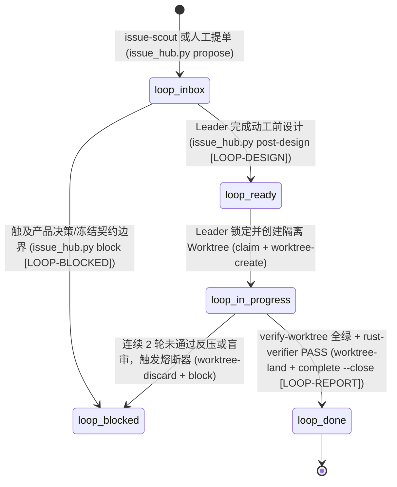

# Akzio 24h Autonomous Agent Loop (`autonomous-loop`)

本技能定义了 `akzio-signal-intelligence` 在 Antigravity 上的 **24h 无人值守研发闭环**：
- **唯一状态中枢**：GitHub Issues（由 `.agents/loop/bin/issue_hub.py` 统一拉取、校验、回写）+ 本地只追加账本 `outputs/loop/state/ledger.jsonl`。
- **模型与角色分层**：
  - **Leader (`loop-leader`, `model: pro`)**：主上下文只做纯调度器，负责 **Stage 1 设计 (`[LOOP-DESIGN]`)**、派单、熔断裁决、**Stage 3 报告 (`[LOOP-REPORT]`) 与完成**、以及 **24h 日报 (`[LOOP-DAILY-REPORT]`)**。
  - **Proposer (`issue-scout`, `model: flash`)**：只读巡检审计台账与源码静态边界，通过 `issue_hub.py propose` 提交带去重指纹的 `loop:inbox` Issue。
  - **Implementer (`rust-worker`, `model: flash`)**：在隔离 Git Worktree (`outputs/loop/worktrees/issue-<N>`) 内执行先红后绿修复，通过 Cargo 四大门禁后提交本地分支 Commit。
  - **Verifier (`rust-verifier`, `model: flash`)**：在全新失忆上下文中执行双轴盲审（`Standards` + `Spec`）与反作弊核查（对比 `loop/nightly...HEAD`）。

---

## 1. GitHub Issues 状态机流转图

---

## 2. Hook 隔离与标记约定（`hook_guard.py`）

- **Leader 波次标记**：`[AKZIO-AUTONOMOUS-LOOP]` —— 由 `loop_daemon.sh` 注入 Leader 会话；触发安全防线、白名单自动放行以及基于 `queue_cache.json` 的有界 `Stop` 续跑。
- **子智能体标记**：`[AKZIO-LOOP-SUBAGENT]` —— 由 Leader 在调用 `invoke_subagent` 时置于 `issue-scout` / `rust-worker` / `rust-verifier` Prompt 首行；仅启用安全防线与白名单自动放行，**绝不触发 `Stop` 续跑**。
- **正常人工对话**：不含上述标记时，`hook_guard.py` 不施加循环限定硬拦截，保持正常交互权限行为。

---

## 3. 核心命令速查（`issue_hub.py`）

| 阶段 | 命令 | 作用与防幻觉保障 |
|---|---|---|
| **初始化** | `python3 .agents/loop/bin/issue_hub.py init-labels` | 在 GitHub 仓库创建/同步 `loop:*` 与 `P1..P3` 标签 |
| **拉取队列** | `python3 .agents/loop/bin/issue_hub.py poll` | 拉取 GitHub Issues，返回决策、`dirty_main_files` 及 `daily_report_due` 并刷新 `queue_cache.json` |
| **发现提单** | `python3 .agents/loop/bin/issue_hub.py propose ...` | 校验候选文件真实存在 + 本地账本与 GitHub 全仓指纹去重，创建 `loop:inbox` Issue |
| **1. 设计** | `python3 .agents/loop/bin/issue_hub.py post-design --issue <N> --allowed-files <csv> --design-file <md> --verdict ready` | 校验白名单路径安全，发布 `[LOOP-DESIGN]` 契约并精确切换为 `loop:ready` |
| **创建隔离区** | `python3 .agents/loop/bin/issue_hub.py worktree-create --issue <N>` | 基于 `loop/nightly` 创建 `outputs/loop/worktrees/issue-<N>`，零污染主工作区 |
| **2. 反压验证** | `python3 .agents/loop/bin/issue_hub.py verify-worktree --issue <N>` | 分文件扫描 `.rs` Diff，拦截 `#[allow]`/`#[ignore]`、逐个校验 `#[test]` 注释、基线感知检查 `include!` 格式并跑通 Cargo 全门禁 |
| **合入分支** | `python3 .agents/loop/bin/issue_hub.py worktree-land --issue <N>` | 校验 `cert-issue-<N>.json == PASS` 且 fast-forward 安全，推进 `loop/nightly` 并清理临时 Worktree |
| **3. 报告与完成** | `python3 .agents/loop/bin/issue_hub.py complete --issue <N> --summary-file <md> --close` | 发布 `[LOOP-REPORT]` 完成报告，改标 `loop:done` 并关闭 Issue |
| **熔断/跳过** | `python3 .agents/loop/bin/issue_hub.py block --issue <N> --reason-code <code> --report-file <md>` | 销毁卡死 Worktree，发布 `[LOOP-BLOCKED]` 并改标 `loop:blocked`，0 人工阻塞跳下一题 |
| **4. 每日日报** | `python3 .agents/loop/bin/issue_hub.py daily-report --hours 24 --publish-github` | 汇总 24h 吞吐、合入 Commit、反压拦截次数与阻塞项，写入本地并发布到 GitHub 日报汇总 Issue |
