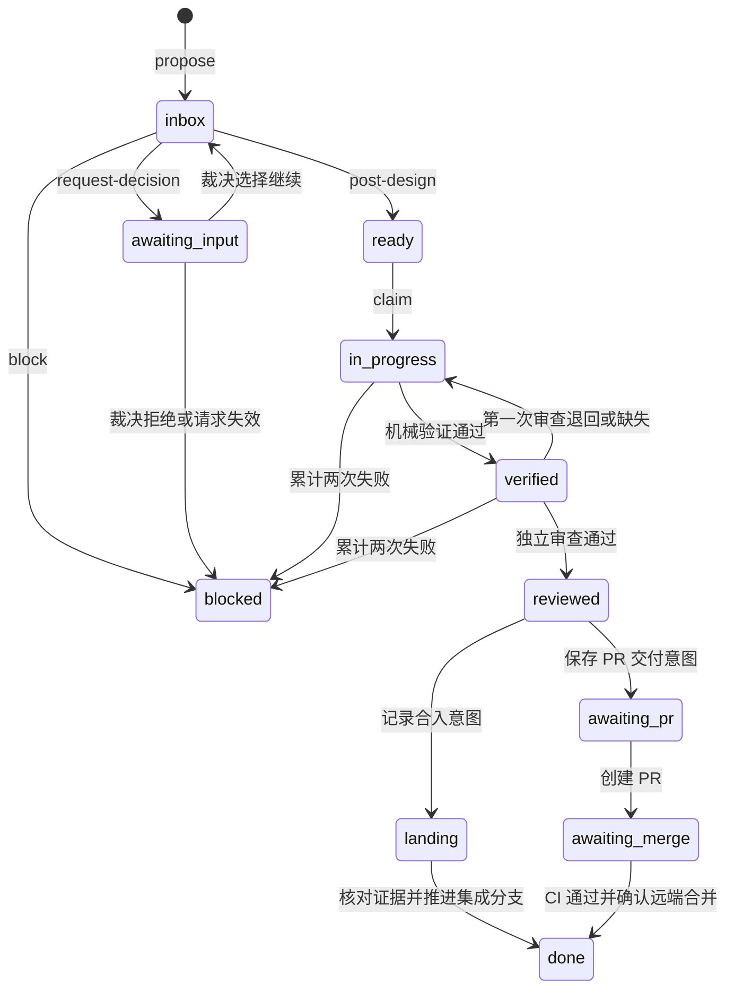

# Akzio 单机研发循环

`outputs/loop/state/loop.sqlite3` 是任务、wave 租约、验证证据和审计事件的权威状态。`issue_hub.py` 负责状态迁移与 Git 操作。新任务 worktree 位于 `outputs/loop/worktrees/task-N-QUEUE`，`QUEUE` 是 SQLite 队列标识。旧任务继续使用已登记的路径。Leader 在本地 `loop/nightly` 集成，启动器使用主工作区交付到 `main`。旧 GitHub Issue、`ledger.jsonl` 和 `issue-N` worktree 保留在原处，如需恢复其中的工作，应按证据重新登记任务。

## 启动与恢复

从仓库根目录运行。`init` 初始化本地状态，`status` 返回本地队列和 `dirty_main_files`。`wave` 启动一次队列动作并执行已配置的交付，`daemon` 每轮还会检查日报是否到期。`daily-report` 立即写本地报告，报告保存在 `outputs/loop/reports/`。

```bash
bash .agents/loop/bin/loop_daemon.sh init
bash .agents/loop/bin/loop_daemon.sh status
bash .agents/loop/bin/loop_daemon.sh wave
bash .agents/loop/bin/loop_daemon.sh daemon
bash .agents/loop/bin/loop_daemon.sh daily-report
```

`list --status blocked` 查看需要处理的阻塞任务，省略 `--status` 列出所有任务。

```bash
python3 .agents/loop/bin/issue_hub.py list --status blocked
```

启动器使用本机已配置的 `agy`，可通过 `AGY_BIN` 指定其路径，通过 `LEADER_MODEL` 指定 AGY 模型标识。`WAVE_INTERVAL_SECS` 默认 `900` 秒。`start-wave` 取得两小时的 SQLite 租约后，启动器从仓库根目录运行带 `--sandbox` 的阻塞式 headless 会话，单次等待上限 110 分钟。`busy` 表示已有 wave 持有租约，此时跳过启动。

会话日志位于 `outputs/loop/logs/`。启动器以 `stream-json` 的 `init` 事件核对工作目录和 `loop-leader` 角色，确认同一会话的最终结果为 `SUCCESS` 后，凭本轮标识调用 `finish-wave`。队列中已有指定任务时，还须核对该任务在 SQLite 中新增的设计、实现、验证或阻塞记录。空转会释放租约并返回 `no_progress`。会话中断或终态无法确认时，租约到期后由下一轮接管任务。每轮使用新的租约，已有候选提交与 worktree 由 `claim` 接管。

## 角色约定

| 角色 | 初始 Prompt 的精确首行 | 职责 |
|---|---|---|
| `loop-leader` | `[AKZIO-LOOP-LEADER] W` | 按 `poll` 结果设计任务或调度实现、验证、合入 |
| `issue-scout` | `[AKZIO-LOOP-SCOUT] W` | 读取本地证据并登记去重的任务 |
| `rust-worker` | `[AKZIO-LOOP-WORKER] W N A` | 按文件白名单在隔离 worktree 修改、定向测试和提交 |
| `rust-verifier` | `[AKZIO-LOOP-VERIFIER] W N SHA` | 对 `verified_head` 的固定差异独立审查一次并持久化裁决 |

`W` 为当前 wave 的 32 位小写十六进制标识，`N` 为任务号，`A` 为当前尝试编号，`SHA` 为完整已验证提交哈希。Hook 按会话的角色、任务和租约限定工具调用与文件范围。循环角色的命令从仓库根目录调用 `python3 .agents/loop/bin/issue_hub.py`，hub 负责在任务 worktree 内执行 Cargo 与 Git。Leader 等待本轮子智能体结束并确认状态已落库后返回。后续动作由 `daemon` 的下一次轮询或手动 `wave` 启动。

## 任务流转



- `poll` 输出 `recommended_action`、`target_task` 和 `dirty_main_files`。选择 `design_inbox`、`execute_ready`、`resume_task` 或 `scout_needed`。`show --task N` 查看冻结设计、候选 SHA 和当前验证状态。
- `propose --title TITLE --priority P2 --area AREA --fingerprint SLUG --candidate-files PATH1,PATH2 --body-file PATH` 登记 `inbox`。`post-design --task N --wave W --allowed-files PATH1,PATH2 --design-file PATH` 冻结设计和文件白名单。需决策时用 `block --task N --wave W --reason-code needs_product_decision|contract_boundary --report-file PATH`。
- `claim --task N --wave W` 创建或接管 worktree。Worker 通过 `worker-test --task N --wave W --attempt A --crate CRATE` 运行定向回归，必要时追加 `--filter NAME`。`worker-commit --task N --wave W --attempt A --message MESSAGE` 记录候选提交。
- `verify-worktree --task N --wave W --attempt A` 记录当前尝试的离线门禁和机械验证。候选提交缺失或 worktree 存在未提交改动也会判为失败。退出码 `2` 表示该失败已计入任务预算，`show --task N` 返回 `last_failure` 供恢复或重试。
- Verifier 用 `show-diff --task N --wave W` 读取已验证的完整差异，再用 `review --task N --wave W --head SHA --verdict PASS|REJECT --summary SUMMARY` 记录同一提交的独立裁决。Verifier 结束后仍为同一 `verified_head` 的 `verified` 状态时，Leader 用 `review-missing --task N --wave W --head SHA` 记录缺失裁决。累计两次验证或审查失败后，hub 将任务置为 `blocked` 并保留 worktree。
- `worktree-land --task N --wave W` 核对机械验证和审查对应同一 SHA，记录合入意图，再推进本地 `loop/nightly` 并持久化 `done` 记录。日报为完成任务标注 `offline-verified`。Hub 根据合入意图恢复中断，并在任务提交进入集成分支后清理干净的任务 worktree 和已合入的任务分支。

## 发布到 main 和 GitHub Issue

在本地 Git 配置中指定一个现有审计 Issue，也可使用 `AKZIO_LOOP_AUDIT_REPO` 与 `AKZIO_LOOP_AUDIT_ISSUE` 覆盖这两个值。启用后，`wave` 和 `daemon` 都会尝试交付。`deliver` 专门重试待交付记录，可独立于 Leader 执行。

```bash
# 把 OWNER/REPO 和 N 替换为仓库及审计 Issue 编号
git config --local akzioLoop.auditRepo OWNER/REPO
git config --local akzioLoop.auditIssue N
bash .agents/loop/bin/loop_daemon.sh deliver
```

启动器在租约释放后交付本地任务的已验收提交。准备快进时，主工作区须处于干净的 `main`。启动器先把验收链推到 `origin/main`，确认后快进本地 `main`，并登记 `task_published`。没有待恢复任务且集成提交已进入本地和远端 `main` 时，Hub 删除 `loop/nightly`。如果 PR 合并先推进了远端，可证明属于当前 Loop 的未发布旧集成链会归档，相关任务回到 `inbox`，在新基线重新验收。

审计发布器按批次追加待发布事件。推送或评论失败时，`daemon` 在下轮重试，`wave` 和 `deliver` 返回失败状态。只需补发审计时运行 `publish-log`。

```bash
bash .agents/loop/bin/loop_daemon.sh publish-log --repo OWNER/REPO --issue N
```

## GitHub 任务和人工裁决

配置已存在的审计 Issue，以及允许启动任务和答复裁决的 GitHub 数字用户 ID。同步程序绑定 `origin` 的 fetch 和 push 地址，首次同步开始接收新命令。运行端 `gh` 凭据需要读取 Actions、写入 Issue 和 PR、合并 PR 的权限，Git 凭据需要推送 PR 分支。验证真实邮件通知时，优先让发布端用有权限的独立账号，审批人在 GitHub 启用参与讨论的邮件通知。发布者和审批人是同一个账号时，按 GitHub 的通知设置确认能否收到自己的更新。

```bash
git config --local akzioLoop.operatorId GITHUB_USER_ID
bash .agents/loop/bin/loop_daemon.sh sync-issues
```

`wave` 和 `daemon` 在执行一轮前后同步。`sync-issues` 可单独补跑。当前同步实例绑定一个仓库。公开仓库只录入、发布可以公开的研发材料。审计 Issue 用于汇总事件。

### 从 Issue 到 PR

1. 在任务 Issue 正文写入 `## Objective`、`## Constraints` 和 `## Acceptance criteria`，每个标题下写清内容。
2. 维护者在本机运行下面的命令，检查输出的 `task` 快照，再把输出的 `command` 原样发为一条新评论。

   ```bash
   python3 .agents/loop/bin/issue_bridge.py prepare --repo OWNER/REPO --issue N
   ```

3. 同步程序核对账号、评论及 Issue 快照摘要，每个 Issue 只登记一次。正文变动时重新生成授权命令。Leader 按现有规则规划，Worker 在隔离 worktree 实现，Verifier 审查机械检查通过的同一个提交。
4. 通过后由启动器推送专用分支并创建 PR。`sync-issues` 等同一个 PR 和验收 SHA 对应的最新 `ci` 工作流全部成功。CI 失败、PR 提交变更、草稿或 GitHub 合并规则阻塞时，PR 保持开放，自动合并检查结果写回 Issue。通过后，启动器带经过验收的 SHA 调用 GitHub squash merge 接口。 [Actions 工作流记录](https://docs.github.com/en/rest/actions/workflow-runs#list-workflow-runs-for-a-workflow) · [GitHub 合并接口](https://docs.github.com/en/rest/pulls/pulls#merge-a-pull-request)
5. 确认合并提交已在 `origin/main` 后，回写原 Issue。原 Issue 内容仍与已批准快照一致时才关闭它。手动关闭未合并的 PR 会暂停该任务，重新打开经过验收的 PR 后可继续。专用分支确认未被修改后自动清理。

### 从裁决到恢复

Leader 将问题登记为 `awaiting_input`。公开请求单独开 GitHub Issue 并通知配置的审批人。本地请求可以用 `show --task N` 查看。以下为 `request-decision` 使用的 JSON 格式。

```json
{
  "question": "选择哪一种方案？",
  "options": {
    "A": {"label": "继续", "impact": "按现有范围重新设计", "resume": true},
    "B": {"label": "暂缓", "impact": "原任务保持阻塞", "resume": false}
  },
  "recommendation": "A"
}
```

在裁决 Issue 评论或回复其通知邮件，正文第一行输入 `CHOOSE 决策编号 A`，末尾替换为选择的字母。Hub 核对审批人、请求版本、已发布原文和有效期，一次记录裁决。选择继续的任务重新回到 `inbox`。请求有效期为七天。过期、远端被编辑或关闭的请求需重新登记，生成新的决策编号。私有决策可在本地执行。

```bash
python3 .agents/loop/bin/issue_hub.py resolve-decision --id DECISION_ID --choice A
```

## 设计依据

- SQLite 的 `BEGIN IMMEDIATE` 将任务迁移和审计登记放在同一个短写事务。Git 合入先保存预期旧 SHA 和已验收的新 SHA，再进行条件引用更新。恢复依据已保存的合入意图和实际引用。 [SQLite 事务](https://www.sqlite.org/lang_transaction.html) · [Git 引用更新](https://git-scm.com/docs/git-update-ref)
- SQLite 中的事件也是待发布日志。发布器在独立调用中追加 GitHub 评论，并核对已发布者、事件标记和返回的评论 ID。GitHub 评论接口未提供幂等键，结果不明时的补发依赖分页对账。 [Transactional outbox](https://docs.aws.amazon.com/prescriptive-guidance/latest/cloud-design-patterns/transactional-outbox.html) · [GitHub Issue 评论接口](https://docs.github.com/en/rest/issues/comments#create-an-issue-comment)

## AGY 官方依据

- 通过 `--agent` 选择角色，通过 `-p` 运行无交互的单次会话。`stream-json` 提供结构化进度和终态，`--print-timeout` 限制等待时长。 [CLI 参考](https://antigravity.google/docs/cli/reference) · [Headless 模式](https://antigravity.google/docs/cli/headless)
- `--sandbox` 为会话请求终端沙箱，四个角色设置 `commandExecutionPolicy: sandbox`。沙箱可用性和访问范围由平台与本机权限配置决定。 [自定义子智能体](https://antigravity.google/docs/subagents/) · [终端沙箱](https://antigravity.google/docs/sandbox)
- 部署时还需用真实 AGY 会话确认角色加载、Headless 的 `PreToolUse` 载荷包含 Hook 所需上下文、子智能体结果回传，以及完成后的租约释放。 [Headless 模式](https://antigravity.google/docs/cli/headless) · [Hook 参考](https://antigravity.google/docs/hooks)
