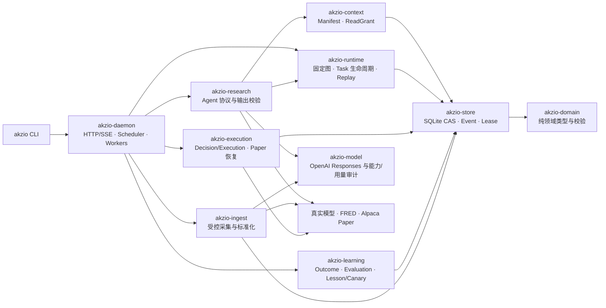
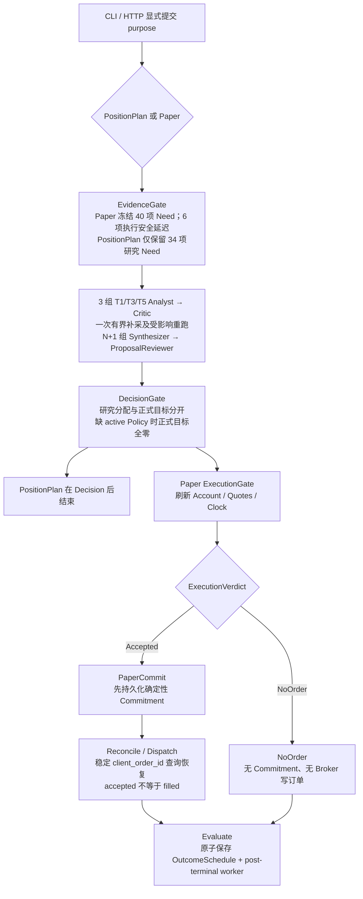
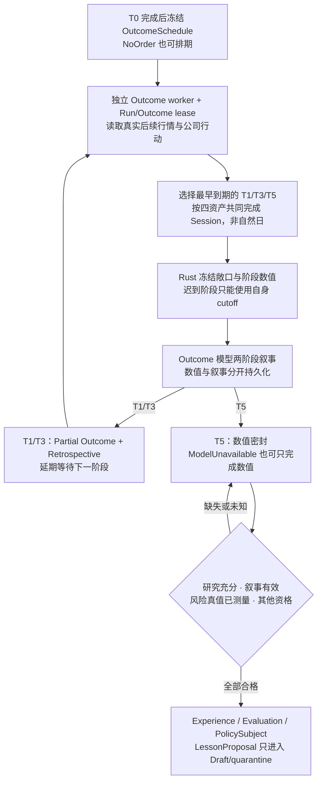

# Akzio 开发协作与架构指南

本仓库是本地常驻、仅支持 Alpaca Paper 的 Rust 多智能体投研系统，提供 CLI 与回环 HTTP/SSE 控制面。本文是开发入口；冻结 Contract、预算和运行时业务协议以 [运行时契约](docs/agent-runtime-contract.md) 与当前源码为准，开发检查以 [开发 Workflow](docs/development-workflow.md) 为准。开发助手所用模型不改变应用模型、冻结身份或交易权限。

## 1. 项目目标与业务红线

目标是在四个 ETF（`TQQQ`、`QQQ`、`SOXX`、`SOXL`）上运行受治理研究，生成仓位计划；Paper 模式在原审批和全部 Gate 通过后提交 Alpaca Paper 订单，并独立积累 T1/T3/T5 Outcome。模型只生成研究或叙事，不拥有状态、资金、工具或执行权限。

- 仅维护 v2；不恢复旧 `orchestrator-*` crates、Phase 0–8、FileStore、旧 prompts 或 `outputs/store` 兼容路径。Rust 工具链固定为 `1.96.0`。
- Live Trading 永不实现；非 Paper endpoint 必须在任何 HTTP I/O 前拒绝。不存在本地模拟账户、时钟或成交适配器，不恢复 `-fakerOnline` / `--faker-online`。
- Rust 是状态、授权、Contract、预算、Gate 与执行策略唯一权威；`akzio-store` 是唯一持久化入口。不得绕过它写 SQLite，不增加改变语义的并行 JSON/文件状态。
- 运行时研究 Agent 只能经 `akzio-context` 获取授权 projections；不开放 RawEvidence、任意文件、SQL、联网或交易工具。开发工具能力不等于运行时 Agent 沙箱。
- Paper、PositionPlan、Shadow 的新 Analyst/Critic/Synthesizer/ProposalReviewer 使用单次结构化 `submit_result`；Outcome 保留 Draft → 受控读取 → Submit。不得恢复旧研究 Draft 或 Planner fallback。
- Planner、PaperDryRun、独立 Debug Core 的创建与执行已退役；历史读取、展示、导出和完整性审计保留。`legacy_workflow_retired` 不是恢复旧入口的理由。
- Paper 写入须先通过原审批和全部 Gate，再持久化确定性 Commitment。PositionPlan 在 Decision 后结束，没有 ExecutionGate、PaperCommit、Reconcile、Evaluate 或 Outcome。
- DecisionPolicy 的风险限制、dataset、候选和激活记录均以 SQL Store/CAS 为权威。缺 active Policy 时正式目标全零；候选生成不等于显式激活，未知风险和缺失校准保持 fail closed。
- 正式私有阶段日志位于 `~/.akzio/log/YYYYMMDD/`；日志/归档故障阻止新的模型与订单写入，但已提交订单保留只读对账及原有受控保护性撤单路径。
- 不静默改写历史 CAS、Contract、Commitment、哈希或迁移边界；旧任务和有效 lease 的升级阻断必须合法处理。Store、BLOB、socket、生成报告、凭据和本地配置覆盖不得提交 Git。

## 2. 实际架构与模块依赖



| 模块 | 实际职责与边界 |
|---|---|
| `akzio-domain` | 稳定 Schema、资产/金额/状态、静态校验；不含 I/O |
| `akzio-store` | CAS BLOB、Artifact DAG、Run/Task/Attempt、事件、lease、Policy/Lesson 与 Doctor |
| `akzio-context` | 从授权候选构建 Manifest、投影与 ReadGrant；不是第二份业务状态 |
| `akzio-ingest` | Alpaca/FRED/官方资料与新闻采集，Raw → Normalized；不允许模型直接调用 |
| `akzio-model` | Responses 协议、能力快照、预算用量和审计；不决定业务授权 |
| `akzio-runtime` | Rust 固定拓扑编译、TaskRuntime、lease/timeout/retry、恢复和 replay |
| `akzio-research` | 冻结 Contract/Prompt、研究单次提交、Outcome 两阶段及恢复 |
| `akzio-execution` | Decision/Execution 双闸门、Allocation、Commitment、Dispatch/Reconcile |
| `akzio-learning` | 共同交易 Session 的 Outcome、独立学习资格、Lesson/Policy/Canary |
| `akzio-daemon` | 组合以上模块，提供调度、Worker、HTTP/SSE；调度层不另造业务 Policy |
| `akzio-cli` | 日常客户端、诊断、校准与导出；不是绕过 Core 的执行后门 |

## 3. 核心业务流程

### 3.1 T0：研究与 Paper 执行



研究节点数实际为 `15 + 2N`，默认 `N=2`；PositionPlan 默认 21 个节点，Paper 默认 25 个。节点存在不代表一定调用模型，refined/reviewer 可明确 skipped。研究 `research_allocation` 不是正式目标、订单或成交。

Paper Session 由真实 Alpaca Clock/Calendar 与美东交易日历决定；扩展/隔夜时段仍须对应 feed、资产资格和 Gate。Closed 延期后重新刷新快照并重跑 Gate；同一 Session slot 复用原 Run，不因失败另造一张图。

### 3.2 双时间轴：Outcome 与学习



Run 的 T0 终态不包含后续 Outcome。`OutcomeSchedule` 只证明已排期；数值密封、叙事有效、学习资格、DecisionPolicy 校准和 Paper 成交是不同事实。Outcome metric v3 是冻结执行后敞口，不是后续真实账户 NAV。

## 4. 数据模型、状态与一致性

Store 当前使用 SQLite 统一 CAS，不建立 `claims`、`orders` 等平铺业务表。以下为**核心字段摘要，不是完整迁移脚本**；完整 DDL 见 `akzio-store` 的 schema 初始化实现。

```sql
CREATE TABLE rebuild_blobs (
    blob_hash TEXT PRIMARY KEY,
    logical_bytes INTEGER NOT NULL,
    stored_bytes INTEGER NOT NULL,
    encoding TEXT NOT NULL,
    payload BLOB NOT NULL
);
CREATE TABLE rebuild_artifacts (
    artifact_id TEXT PRIMARY KEY,
    kind TEXT NOT NULL,
    blob_hash TEXT NOT NULL REFERENCES rebuild_blobs(blob_hash),
    producer TEXT NOT NULL,
    lifecycle TEXT NOT NULL,
    provenance_json TEXT NOT NULL,
    origin_json TEXT,
    created_at TEXT NOT NULL
);
CREATE TABLE rebuild_artifact_refs (
    artifact_id TEXT NOT NULL REFERENCES rebuild_artifacts(artifact_id),
    source_artifact_id TEXT NOT NULL REFERENCES rebuild_artifacts(artifact_id),
    source_kind TEXT NOT NULL,
    PRIMARY KEY (artifact_id, source_artifact_id)
);
CREATE TABLE rebuild_runs (
    run_id TEXT PRIMARY KEY,
    purpose TEXT NOT NULL,
    topology_id TEXT NOT NULL,
    graph_artifact_id TEXT NOT NULL REFERENCES rebuild_artifacts(artifact_id),
    status TEXT NOT NULL,
    created_at TEXT NOT NULL,
    finished_at TEXT
);
CREATE TABLE rebuild_tasks (
    task_id TEXT PRIMARY KEY,
    run_id TEXT NOT NULL REFERENCES rebuild_runs(run_id),
    recipe_id TEXT NOT NULL,
    contract_hash TEXT,
    budget_json TEXT NOT NULL,
    retry_json TEXT NOT NULL,
    node_spec_json TEXT,
    status TEXT NOT NULL,
    ready_at TEXT NOT NULL,
    lease_id TEXT,
    lease_epoch INTEGER NOT NULL DEFAULT 0,
    active_attempt_id TEXT,
    lease_until TEXT
);
CREATE TABLE rebuild_attempt_outputs (
    attempt_id TEXT NOT NULL REFERENCES rebuild_attempts(attempt_id),
    task_id TEXT NOT NULL REFERENCES rebuild_tasks(task_id),
    artifact_id TEXT NOT NULL REFERENCES rebuild_artifacts(artifact_id),
    event_id INTEGER NOT NULL UNIQUE REFERENCES rebuild_events(event_id),
    PRIMARY KEY (attempt_id, artifact_id)
);
CREATE TABLE rebuild_session_slots (
    session_key TEXT PRIMARY KEY,
    run_id TEXT NOT NULL,
    graph_artifact_id TEXT NOT NULL REFERENCES rebuild_artifacts(artifact_id),
    scheduler_epoch INTEGER NOT NULL,
    commitment_artifact_id TEXT REFERENCES rebuild_artifacts(artifact_id),
    committed_at TEXT
);
```

其他表族包括 `rebuild_events`、`rebuild_attempts`、`rebuild_task_dependencies`、`rebuild_daemon_leases`、`rebuild_run_controls`、Contract/DecisionPolicy 安装与激活、Paper effect/审批消费、Policy evaluation/transition、Lesson、Shadow 和 Canary。

- **状态**：Task SQL 主状态为 `queued/running/succeeded/failed/cancelled/skipped`；领域 `Pending` 对应 SQL `queued`。Retry/Deferred/过期 Recovery 可回到 queued，但 Attempt 分别留下 `retried/deferred/abandoned` 等历史。Run replay 将 T0 归并为 queued/running/completed/failed/cancelled，post-terminal worker 不延长 T0。
- **Artifact**：生命周期为 `ephemeral/run_scoped/canonical`。staged BLOB、已写阶段 Artifact、成功 Attempt 的正式输出是三层不同事实；下游只读声明依赖闭包中的成功输出。
- **并发**：Task permit 绑定 Run/Task/Attempt/lease/epoch；最终写事务重新校验。StoreExecutor 串行执行同步 Store 闭包，但不替代 SQLite 事务、跨进程 lease 或 fencing。
- **重试**：按冻结 RetryPolicy、失败原因和 SQL 次数决定；Deferred 不消耗失败预算。Outcome 退避至少 30 秒、上限 5 分钟，并在已提交阶段边界重新计数。
- **Paper 幂等**：Session slot 排他 + 确定性 client ID + Broker 前 Commitment + effect intent/recovered/settled。它防止已知路径重复下单，不承诺外部副作用 exactly-once。
- **提交歧义**：`unknown_after_post` 时先查询原 Run/Session；CLI 与 HTTP 均不得自动重发。客户端断开不撤销已持久化图或订单。

## 5. 开发协作与任务上下文

- 默认中文，先给结果和必要证据。实施请求推进到修改、验证和交付；只审阅/分析的请求不修改源码。开始修改前检查工作区，保留无关改动；提交、格式化、清理不得顺带处理他人工作。
- 从现有上下文和代码解决普通选择。只有无法推断且会改变业务结果、范围、授权或难以撤回选择的信息才询问；继续不依赖答案的工作。
- 删除、工作区外写入、生产、凭据、发布及其他明确审批要求继续有效；不把可逆操作、文件存在或工具可用当作额外授权。
- 优先 `rg`、现有 CLI/连接器和仓库脚本。独立只读检查可并行；依赖动作及有副作用操作顺序执行。派发、计划和中间结果不等于完成。
- 按任务使用会话中可用 Skill；本仓库项目副本位于 `.agents/skills/`。只加载当前阶段所需内容，不为 Skill 初始化无关配置或新增审批门。

| 任务涉及 | 修改或执行前读取并核对 |
|---|---|
| Rust、领域模型、持久化 | 运行时契约第 1、2、4 节及功能章节；需要术语时查 `CONTEXT.md`，但其版本字段可能漂移 |
| 研究拓扑、Prompt、预算、Context、Evidence | 运行时契约第 3、5、6、11、12 节；同步检查 Contract、Prompt 消费方和 Rust 校验 |
| Decision、Execution、Broker、学习、迁移 | 运行时契约第 3、7、8、11、12 节；核验冻结来源、版本、Gate 和实际恢复路径 |
| 正式日志、真实模型、Core 联调 | 运行时契约第 12 节与 [运行日志](docs/run-log.md) |
| 旧链退役、历史兼容 | [研究协议与退役清单](docs/research-protocol-retirement.md)；区分历史读取与活动创建/执行 |
| DecisionPolicy 缺失、校准 | 开发 Workflow 的 readiness 与 SQL collect/build/inspect/validate/activate；不伪造样本或模型身份 |
| 测试、CI、打包、交付 | 开发 Workflow 的相关分支及 `.github/workflows/ci.yml` 实际配置 |
| 历史问题或特定验收 | 相关文件 Git 历史和当次运行证据；历史结果不视为当前验证 |

## 6. 日常运行、构建与验证

先配置真实模型/行情。日常脚本只提供两个正式运行动作，均调用同一个 `POST /runs`：

```bash
bash scripts/run_core.sh position-plan
bash scripts/run_core.sh paper
```

- `position-plan` 调用真实 LLM，Decision 后结束，不提交订单、不安排 Outcome；`paper` 仍可能 NoOrder，不承诺下单或成交。
- 脚本复用已有正式 Core；仅在回环端口明确未监听时，用同一配置启动并等待 ready。端口占用、token/身份错误或超时不启动第二个 Core；`auto_paper=true` 时 PositionPlan 拒绝自动启动。
- 默认配置为 `~/.akzio/config.toml`，仅可在模式前用 `--config FILE`。脚本使用当前源码的 Rust CLI，不改模型、Store、Policy、审批或定时开关，不等待 Run 完成，不自动导出或清理。
- 自启 Core 在脚本退出后继续处理 Reconcile/Outcome，输出 `CORE_STARTED_PID`、`CORE_LOG`。用同一配置的 `akzio run replay/detail <RUN_ID>` 查询，不重复启动第二个 Core。

代码改动先做窄域回归，再按 [开发 Workflow](docs/development-workflow.md) 运行适用检查：

```bash
cargo fmt --all -- --check
cargo check --workspace --locked
cargo clippy --workspace --all-targets --all-features --locked -- -D warnings
cargo test --workspace --locked
```

只改文档时检查差异和本地 Markdown 链接，运行 `git diff --check`，不因此启动 Core、模型、Paper 或 T+5。正式拓扑离线验证在 Cargo 测试内，不新增根 `tests/`；Shell/HTTP 边界回归由 `akzio-cli` 覆盖。

交付分别报告研究提案、正式 Decision、ExecutionVerdict、订单提交、成交和 Outcome。`implemented`、`offline-verified`、`real-Paper-verified`、`outcome/learning-verified` 只描述实际证据；`NoOrder` 可以是完整业务结果，fixture、只读 API 或 accepted 不能标成真实成交或正式校准完成。

## 7. 当前进度与已知问题（2026-11-02 快照）

本节是短期状态，后续完成修复或取得新证据后更新，不作为永久契约。

### 7.1 功能状态

| 范围 | 状态 | 当前证据与限制 |
|---|---|---|
| 固定研究图、Context、Contract、预算、补采/修订 | 已实现 | 有离线回归；本轮未做真实模型语义评测 |
| PositionPlan、Paper 双闸门、Commitment、Reconcile | 已实现，存在边界问题 | 离线测试通过；真实 Paper 未在本轮验收，恢复与卖出数量见 P1 |
| CAS、事件、lease、Replay、Doctor、迁移 | 已实现 | 当前 Store 18、Domain 10、WorkflowDefinition 1；历史对象仍按自身冻结身份读取 |
| Outcome 排期、Rust 数值与 LLM 叙事/repair | 已实现并离线验证 | T1/T3/T5 及 repair 回归通过；未做真实模型或跨交易日验收，学习资格仍独立 |
| SQL DecisionPolicy 校准 | 已实现操作流程，部署状态待确认 | 未读取本机 Store，未知 active Policy/成熟样本；不自动激活 |
| PolicySubject、Lesson、Shadow、Canary | 部分完成 | 有模型、Store 和消费逻辑；独立风险真值生产、Lesson 正文消费及完整晋升链未闭合 |
| 旧 Planner/PaperDryRun/Debug 执行 | 已退役 | 仅保留历史读取、展示、导出和审计，不应恢复 |

当前源码版本：研究 Contract 69 / PromptBundle 38 / freshness candidate 70；Outcome Contract 63 / PromptBundle 35；Outcome metric v3。其他文档出现旧版本时，不回写历史 CAS，先核对当前源码与具体 Run。

### 7.2 轻量审计结果

本轮未发现可判为 P0 的证据。以下均为源码可定位问题或明确缺口，不代表已发生真实账户事故：

- **P1 — Reconcile 活性不足**：默认 Reconcile retry 为 none，传输错误和外层 timeout 可终止 Task；已有 Session 只复用并告警。已有 effect 的过期 recovery 有特别保护，但不能据此声称所有异常都会自动对账。补故障注入覆盖 timeout、transport、crash 与最终 Outcome 排期。
- **P1 — 卖单未按持仓数量封顶**：`akzio-execution` 从市值差和保护限价换算卖出 qty，未使用 `Position.quantity_micros` 做上限。存在生成超持仓卖单的静态边界；先补代数/协议回归，再决定最小修复，不能声称已发生超卖。
- **P2 — 学习闭环未完整接线**：仓库内未见 `record_risk_ground_truth_assessment_fenced` 的生产调用；缺风险真值会合法阻断学习。默认 Lesson/Experience/CandidatePolicy 进入 Manifest 时仅落 metadata，研究角色又无读取工具，不能把“召回”写成“正文已被模型使用”。
- **P2 — CI 主分支覆盖不一致**：`.github/workflows/ci.yml` 的 push 仅列 `master`，当前主分支为 `main`；PR 仍触发，但 main push 不会按该配置触发。先修正分支配置并保留现有检查。
- **P2 — 提交歧义分类过宽**：scheduler 将 reservation 闭包的全部错误及 canary tick 错误统一映射为 `SubmissionUnknown`，确定的事前校验/lease 拒绝也会变成 `unknown_after_post`。保留已提交后审计失败的保守歧义，但应区分明确拒绝与未知提交，并补负向回归。
- **P2 — 格式化检查存在 include 盲区**：多个 `include!` 实现文件未被 `cargo fmt --all -- --check` 覆盖；直接对这些文件运行 `rustfmt --check` 已有差异。不要为了本轮审计顺带全量格式化。
- **P2 — 文档版本和口径漂移**：`CONTEXT.md`、`agent-budget-configuration.md`、`research-protocol-retirement.md` 仍有旧版本；运行时契约的 Artifact refs 字段名也与 DDL 不符。以源码为准逐项修正，不批量改写历史报告。
- **P3 — 通用 CLI HTTP 缺少默认整体超时**：`ControlApiClient` 本身未配置总 timeout，部分正式 Run 调用单独设置；其余普通 JSON 操作仍可能无限等待。按操作增加有界超时，SSE 保持独立策略。

### 7.3 本轮已修复（Outcome）

- 普通 Outcome 与 narrative repair 不再克隆并改写冻结 `objective`；horizon、cutoff 和原数值事实继续由持久化阶段材料及 candidates 提供，AgentRuntime 的完整节点身份校验保持有效。
- Agent 恢复在父 Attempt 已提交 `RetrospectiveCreated` 后停止回溯，T1→T3→T5 使用新的阶段 Context 和独立预算；同阶段未完成的 Retry/Recovery 仍按原血缘恢复，不再把新阶段误报为 `ProviderUsageUnknown`。
- `request_outcome_narrative_repair` 与新 repair Task 在同一事务唤醒普通 RunControl，避免 T5 完成后新任务永远无法领取。
- 新增真实 Daemon + Store + 离线 bars/模型 adapter 回归，覆盖三阶段 `Complete` 叙事、数值密封及 ModelUnavailable 后的 repair。该证据仅为 `offline-verified`。

### 7.4 建议顺序

1. **补 Reconcile 故障恢复和卖单持仓上限回归**：先解决执行安全与最终对账活性，再做获准的真实 Paper 验证。
2. 明确独立风险真值与 Lesson 正文消费的设计/操作入口，避免把类型存在当作学习闭环完成。
3. 处理 CI 主分支和文档漂移。

本轮验证只证明当前工作树的离线编译/测试和文档检查，不是 `real-Paper-verified` 或 `outcome/learning-verified`。具体 Run ID、样本数、本地配置缺口和当次真实验收留在运行证据中，不固化为长期规则。
